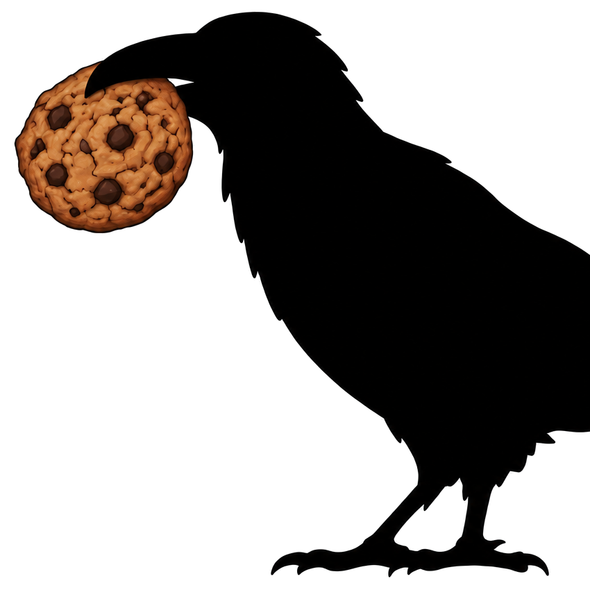

  

<h1 align="center">Raven Pop-up Remover</h1>

  
  

  A Chrome extension offering automatic removal of cookie queries especially for Cambridge University websites.

## Usage

1. Download this repository into a folder you like.
2. Open `chrome://extensions` and enable Developer mode. Choose `Load unpacked`.
3. Click the raven icon at the top-right corner of the browser; choose `Accept all`, `Reject all`, or `Off`.
4. To suppress automatic click on the current website, check `Never act on this website`.

Some sites may not be recognised.

